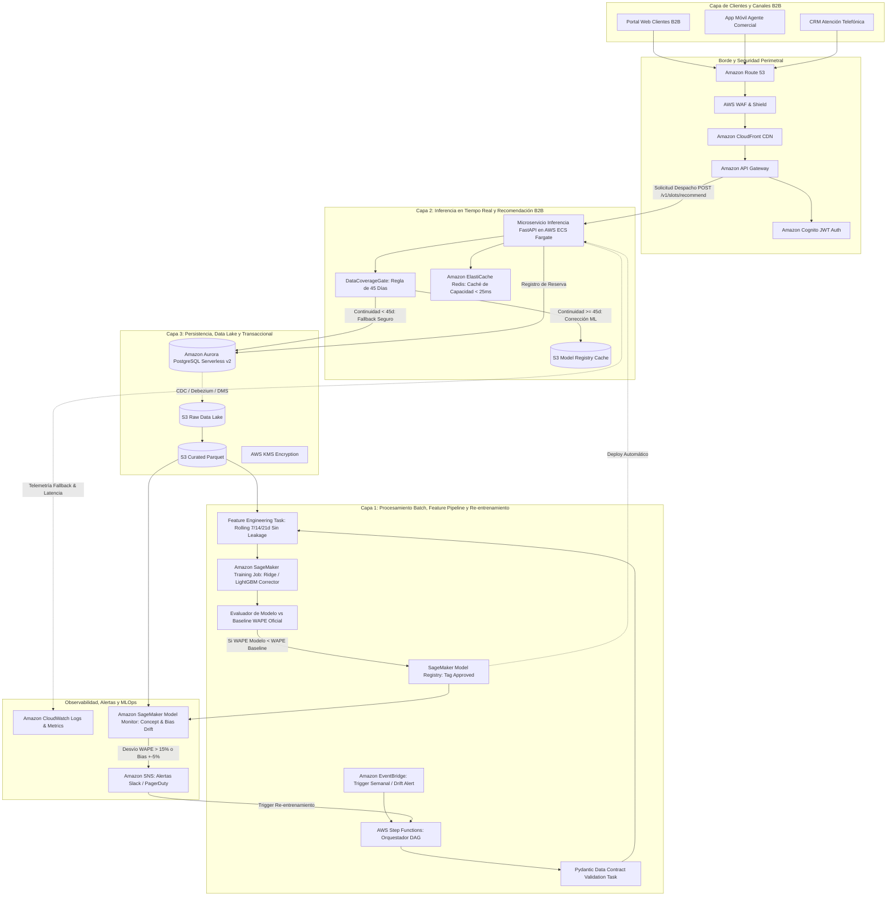

# Especificación Técnica de Arquitectura e Infraestructura Cloud en AWS

**Proyecto:** Plataforma B2B de Recomendación de Despacho y Corrección de Pronóstico Logístico  
**Rol Evaluado:** Data Scientist Lead  
**Documento:** Diseño Conceptual de Arquitectura, MLOps y Resiliencia (Tarea 5)  

---

## 1. Visión General de la Solución

Para operacionalizar el sistema de corrección analítica de demanda, asignación dinámica de capacidad (*Dynamic Delivery Slotting*) y resiliencia ante arranque en frío (*Cold Start*), se diseña una arquitectura en la nube de **Amazon Web Services (AWS)** con tres capas desacopladas, alta disponibilidad (Multi-AZ), seguridad estricta y observabilidad continua.

---

## 2. Detalle de Componentes por Capa Arquitectónica

### 2.1. Capa 1: Procesamiento Batch, Feature Engineering y Re-entrenamiento
Diseñada para cómputo desacoplado, costo-eficiente y reproducible.

- **Amazon EventBridge Scheduler:**
  - Dispara la ejecución del pipeline con frecuencia programada (semanal, domingos 23:00 UTC) o reactiva (cuando se dispara una alerta de degradación de métricas).
- **AWS Step Functions (Orquestador Serverless):**
  - Orquesta el grafo dirigido acíclico (DAG) de tareas con manejo declarativo de reintentos con backoff exponencial.
  - *Paso 1: Validación de Contratos:* Ejecuta el contenedor con esquemas Pydantic (`PedidoHistoricoRecord`, `PronosticoDemandaRecord`, `CapacidadLogisticaRecord`). Si se detecta un error de integridad referencial o valores nulos, la ejecución se detiene y alerta a Data Engineering.
  - *Paso 2: Ingeniería de Características:* Procesa en contenedores ligeros las transformaciones temporales (lags, `mean_7d`, `mean_14d`, `mean_21d`, `ratio_base_to_mean7`, interacciones con picos de martes) garantizando la condición de *zero data leakage* con respecto a la fecha de emisión.
  - *Paso 3: Amazon SageMaker Training Job:* Entrena el modelo complementario de corrección residual (`Ridge(alpha=10.0)` / `LightGBM Regressor`) aprovisionando instancias bajo demanda o Spot (`c6i.xlarge`), reduciendo los costos computacionales en hasta un 70%.
  - *Paso 4: Validación Automática contra Baseline (Gate de Calidad):* Compara el WAPE y Bias del modelo candidato contra los benchmarks congelados de la Fase 2 (`baseline_metrics_summary.csv`). Solo si el WAPE candidato es inferior al baseline y el sesgo se ubica en el intervalo $[-2\%, +2\%]$, se avanza a producción.
  - *Paso 5: Amazon SageMaker Model Registry:* Registra el artefacto serializado, metadata de entrenamiento, versión del dataset y aprueba el modelo para despliegue en producción.

---

### 2.2. Capa 2: Servicio de Recomendación e Inferencia en Tiempo Real
Expone endpoints RESTful con latencias de respuesta menores a 50 milisegundos hacia el portal B2B y las herramientas de ventas.

- **Amazon API Gateway:**
  - Punto de entrada unificado y seguro. Gestiona throttling (10,000 req/min), autenticación mediante tokens JWT emitidos por **Amazon Cognito**, versionado de rutas (`/v1`, `/v2`) y validación de esquemas JSON en el borde.
- **Microservicio de Inferencia en AWS ECS Fargate:**
  - Implementado en **FastAPI (Python 3.12+)** empaquetado en contenedores Docker livianos corriendo en ECS Fargate con autoscaling horizontal basado en utilización de CPU y volumen de peticiones concurrentes.
  - **Middleware `DataCoverageGate` (Regla de 45 días):**
    - Inspecciona la continuidad histórica del Centro de Distribución solicitado.
    - Si el centro posee $\ge 45$ días continuos de historia $\implies$ invoca el modelo corrector ML (`ADVANCED_MODEL`).
    - Si el centro se encuentra en *Cold Start* ($< 45$ días continuos o con huecos de fechas) $\implies$ conmuta automáticamente al pronóstico base (`SAFE_FALLBACK`) sin generar ninguna excepción runtime hacia el usuario final.
  - **Motor de Recomendación de Fechas (Dynamic Slotting):**
    - Consulta la capacidad máxima diaria del CD en `Aurora PostgreSQL` y calcula las unidades disponibles restando los pedidos ya confirmados.
    - Genera la recomendación de días de despacho en semáforo:
      - **Verde (Día Valle / Jueves o Viernes):** Con descuento comercial logístico aplicado automáticamente.
      - **Amarillo (Día Estándar):** Ocupación entre 50% y 80%.
      - **Rojo (Día Pico Saturado / Martes >80%):** Con recargo por alta demanda o redirección sugerida hacia días valle.
- **Amazon ElastiCache (Redis):**
  - Mantiene en memoria ultra-rápida ($< 5$ ms) la disponibilidad de cupos de despacho por centro y día de los próximos 14 días. Las confirmaciones de compra descuentan atómicamente el saldo en Redis (`DECRBY`) evitando condiciones de carrera (*race conditions*) en compras concurrentes.

---

### 2.3. Capa 3: Persistencia, Data Lake y Gobernanza
Garantiza durabilidad, consistencia transaccional y cumplimiento de seguridad.

- **Amazon S3 (Data Lake con Arquitectura Medallion):**
  - `s3://b2b-logistics-lake/raw/`: Almacena eventos crudos y desgloses por canal (`PORTAL_WEB`, `AGENTE_COMERCIAL`, `ATENCION_TELEFONICA`).
  - `s3://b2b-logistics-lake/curated/`: Tablas limpias en formato Parquet comprimido con Snappy, particionadas por `centro_distribucion=CD_XX/año=YYYY/mes=MM/`.
  - `s3://b2b-logistics-lake/artifacts/`: Repositorio inmutable de pesos de modelos, transformadores y reportes de validación.
- **Amazon Aurora PostgreSQL Serverless v2:**
  - Almacena entidades relacionales críticas: catálogo de centros, capacidad máxima diaria, planes comprometidos por cliente y transacciones de reservas confirmadas. Escala automáticamente su capacidad de 0.5 a 16 ACUs según la demanda de pedidos.
- **Seguridad y Cifrado:**
  - Cifrado en reposo en S3 y Aurora mediante **AWS KMS (Key Management Service)** con rotación automática de llaves.
  - Cifrado en tránsito forzado vía TLS 1.3 en todas las comunicaciones.
  - Aislamiento en VPC (Virtual Private Cloud) con subredes privadas para cómputo de ECS y bases de datos, sin acceso público directo a internet (salida vía NAT Gateway).

---

### 2.4. Capa 4: Observabilidad, Alertas y Detección de Drift (MLOps)
Monitoreo continuo para garantizar que el modelo no se degrade silenciosamente en producción.

- **Amazon CloudWatch (Logs y Métricas):**
  - Centraliza logs de eventos y emite métricas personalizadas:
    - `InferenceLatencyMs` (p50, p95, p99).
    - `ColdStartFallbackCount` (conteo de activaciones de resguardo por centro).
    - `CapacitySaturationExceededCount` (días con desborde de flota).
- **Amazon SageMaker Model Monitor (Concept & Data Drift):**
  - Contrasta semanalmente las predicciones emitidas contra las unidades reales entregadas una vez cerrado el ciclo logístico.
  - Si el **WAPE observado supera el 12.0%** (degradación respecto al 7.28% obtenido en el backtest) o si el **Bias se desvía más de $\pm 4.0\%$**, dispara una alerta de alta prioridad.
- **Amazon SNS (Simple Notification Service):**
  - Enruta notificaciones críticas al canal de ingeniería en Slack y PagerDuty, y gatilla un re-entrenamiento automático en Step Functions para absorber el cambio estructural de demanda.

---

## 3. Estimación de Costos Operativos Mensuales (AWS FinOps)

| Componente AWS | Especificación / Dimensionamiento | Costo Estimado Mensual (USD) |
| :--- | :--- | :---: |
| **AWS ECS Fargate** | 2 tareas corriendo 24/7 (0.5 vCPU, 1 GB RAM c/u) con auto-scaling | $35 - $50 |
| **Amazon ElastiCache Redis** | 1 nodo `cache.t4g.small` (Single-AZ para desarrollo, Multi-AZ prod) | $25 - $55 |
| **Amazon Aurora PostgreSQL** | Serverless v2 (promedio 1 ACU en horario valle, picos de 4 ACUs) | $60 - $90 |
| **Amazon S3 Data Lake** | ~50 GB almacenados en S3 Standard + consultas periódicas | $2 - $5 |
| **AWS Step Functions & Batch** | ~4 re-entrenamientos al mes en instancias Spot `c6i.xlarge` | $5 - $10 |
| **Amazon API Gateway & CloudFront** | ~1 millón de peticiones B2B al mes con compresión gzip | $4 - $8 |
| **Amazon CloudWatch & SNS** | Logs de microservicios, métricas y alarmas | $10 - $15 |
| **Total Estimado Mensual** | **Arquitectura Serverless / Pay-per-use Altamente Optimizada** | **~$140 - $230 USD/mes** |

*Retorno de Inversión (ROI):* Un solo flete spot de emergencia de larga distancia en el mercado logístico regional cuesta entre $400 y $1,200 USD. La infraestructura cloud completa se amortiza con evitar **un solo viaje spot al mes**.
