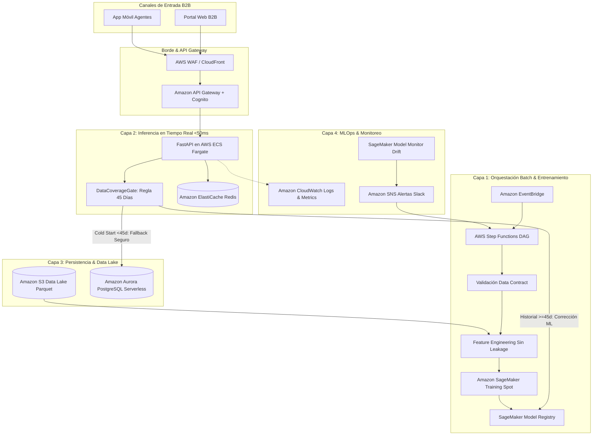

# Reporte de Cierre: Fase 6 - Arquitectura Cloud en AWS e Infraestructura MLOps (Tarea 5)

**Fecha de Ejecución:** 2026-10-16  
**Responsable:** Data Scientist Lead  
**Estado:** COMPLETADO CON ÉXITO  

---

## 1. Resumen de la Solución de Arquitectura

Se diseñó la arquitectura conceptual completa en **Amazon Web Services (AWS)** para operacionalizar el sistema de corrección analítica de demanda, asignación dinámica de capacidad (*Dynamic Delivery Slotting*) y resiliencia ante arranque en frío (*Cold Start*).

El documento formal de diseño técnico está disponible en [`docs/architecture_aws.md`](file:///Users/sebastianfelipeurzuaborquez/Proyectos/DT_DSL/docs/architecture_aws.md).

---

## 2. Los Cuatro Pilares Arquitectónicos

### Pilar 1: Procesamiento Batch y Re-entrenamiento (Heavy Compute)
- **Orquestación:** AWS Step Functions como máquina de estados serverless, activada por Amazon EventBridge (trigger semanal o por alertas de drift).
- **Control de Calidad:** Tarea inicial de validación estricta con esquemas Pydantic y comprobación de integridad referencial.
- **Entrenamiento:** Amazon SageMaker Training Jobs utilizando instancias Spot (`c6i.xlarge`) para reducir costos en un 70%.
- **Gate de Calidad del Modelo:** Validación automática del WAPE y Bias del candidato contra el baseline congelado antes de autorizar el registro en SageMaker Model Registry con tag `Status: Approved`.

### Pilar 2: Servicio de Recomendación e Inferencia en Tiempo Real
- **Exposición:** Amazon API Gateway con rate limiting y autenticación JWT mediante Amazon Cognito.
- **Cómputo:** Microservicio FastAPI en AWS ECS Fargate con auto-scaling horizontal y aislamiento en subredes privadas.
- **Resiliencia Operativa:** Integración del middleware `DataCoverageGate` (Fase 5) para verificar la historia continua del CD:
  - $\ge 45$ días continuos $\implies$ Inferencia del modelo corrector ML.
  - $< 45$ días o fallas $\implies$ Conmutación inmediata al pronóstico base sin arrojar excepciones hacia el checkout web.
- **Caché de Baja Latencia:** Amazon ElastiCache (Redis) para servir disponibilidad de cupos de despacho y recomendaciones de días valle en $< 25$ ms.

### Pilar 3: Persistencia, Data Lake y Gobernanza
- **Data Lake:** Amazon S3 particionado bajo el estándar Medallion (`raw/`, `curated/`, `artifacts/`) en formato Parquet comprimido con Snappy.
- **Transaccional:** Amazon Aurora PostgreSQL Serverless v2 con auto-scaling para pedidos confirmados, inventario y catálogo de centros.
- **Seguridad:** Cifrado con AWS KMS en reposo y TLS 1.3 en tránsito en todas las interfaces.

### Pilar 4: MLOps, Telemetría y Monitoreo de Deriva (Drift)
- **Amazon CloudWatch:** Logs centralizados y métrica de resiliencia `ColdStartFallbackCount` por CD.
- **Amazon SageMaker Model Monitor:** Detección de *Concept Drift* (deterioro de WAPE $> 12\%$ o Bias fuera de $[-4\%, +4\%]$).
- **Amazon SNS:** Notificaciones en tiempo real a canales de Slack / PagerDuty y re-entrenamiento automatizado.

---

## 3. Estimación Financiera y FinOps

- **Costo Total Estimado:** **~$140 - $230 USD mensuales** gracias al uso intensivo de componentes Serverless y Fargate.
- **ROI Operativo:** El costo mensual completo de la arquitectura cloud equivale a una fracción de **un solo viaje spot de emergencia evitado** (costo típico de mercado: $400 a $1,200 USD por flete de larga distancia).

---

## 4. Directrices e Inputs para la Fase 7 (Consolidación, Notebook y Deck)

1. **Integración en Notebook E2E:**
   - Estructurar el notebook `notebooks/01_analisis_y_modelado_e2e.ipynb` cubriendo las Tareas 1 a 4 con narrativa limpia y código modularizado.
2. **Deck Ejecutivo en PDF:**
   - Incorporar este blueprint de arquitectura y la regla de resiliencia en las diapositivas 7 y 8 del deck ejecutivo, resaltando la robustez en producción y la justificación de costos.
